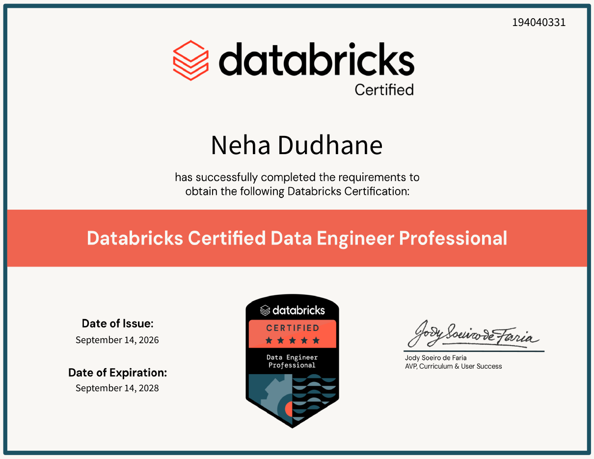

# Hi, I'm Neha Dudhane 👋

### AI Data Engineer • Data Engineering • Applied GenAI

**Building reliable data pipelines and turning enterprise knowledge into useful AI experiences.**

---

### 👩‍💻 About me

I'm a data engineer working across **Azure, Databricks, Snowflake, SQL, and Python**, with a growing focus on **retrieval-augmented generation (RAG)** and applied AI. I enjoy building the full path from raw data ingestion to curated analytics and AI-powered applications.

- 🔧 **Data engineering:** ETL/ELT, PySpark, streaming, incremental processing, dimensional modeling
- ☁️ **Cloud & platforms:** Microsoft Azure, Azure Data Factory, Databricks, Snowflake
- 🧠 **Applied AI:** document ingestion, embeddings, hybrid search, reranking, LLM-based Q&A
- 📊 **Analytics:** SQL, dbt, Power BI
- 🎯 **Focus:** AI Data Engineering and scalable data platforms

### 🏆 Certification

**Databricks Certified Data Engineer Professional**

**Issued:** September 14, 2026 · **Valid through:** September 14, 2028

[📄 View certificate (PDF)](certifications/databricks-data-engineer-professional.pdf)

### 🧰 My toolkit

### 🚀 Featured projects

<table>
<tr>
<td width="50%" valign="top">

**🧠 [Advanced Hybrid RAG Assistant](https://github.com/nehadudhane/AI-advanced-rag-project)**

Healthcare knowledge assistant built with synthetic PDF documents, **ChromaDB**, **BM25**, reciprocal rank fusion, **cross-encoder reranking**, **Groq**, and **Streamlit**.

`Python` · `RAG` · `Embeddings` · `Hybrid Search`

</td>
<td width="50%" valign="top">

**❄️ [ODI Cricket Analytics — Snowflake](https://github.com/nehadudhane/cricket-snowflake)**

Semi-structured JSON ingestion with Snowflake stages, raw and clean data transformations, and a fact/dimension consumption model.

`Snowflake` · `JSON` · `LATERAL FLATTEN` · `SQL`

</td>
</tr>
<tr>
<td width="50%" valign="top">

**⚡ [Databricks Declarative Pipelines](https://github.com/nehadudhane/declarativepipeline)**

Bronze–Silver–Gold pipelines with streaming ingestion, quality expectations, **Auto CDC**, and **SCD Type 1/2**.

`Databricks` · `PySpark` · `Streaming` · `CDC`

</td>
<td width="50%" valign="top">

**📦 [Databricks Asset Bundles](https://github.com/nehadudhane/assetbundle)**

Databricks project demonstrating asset bundle structure, job definitions, and deployment-oriented configuration.

`Databricks` · `Asset Bundles` · `Jobs` · `YAML`

</td>
</tr>
</table>

### 📂 More projects

| Area | Repository | Highlights |
|---|---|---|
| **Snowflake** | [Swiggy Food Delivery Analytics](https://github.com/nehadudhane/swiggy-snowflake) | Incremental data processing, facts, dimensions, KPI views |
| **Azure** | [Azure Data Factory](https://github.com/nehadudhane/Azure-Devops) | Ingestion, orchestration, ARM templates |
| **Databricks** | [Unity Catalog](https://github.com/nehadudhane/unity-catalog) | Managed/external tables, volumes, Auto Loader |
| **Delta Lake** | [Delta Lake Fundamentals](https://github.com/nehadudhane/deltalake) | Schema evolution, MERGE, time travel, Change Data Feed |
| **Analytics** | [Uber Trip Analysis — Power BI](https://github.com/nehadudhane/uber-power-bi-analysis) | Trip analytics report and dashboard screenshots |
| **dbt** | [dbt Transformations](https://github.com/nehadudhane/dbt-transformations) | Staging models, intermediate models, YAML tests, Jinja macro |

---

### ✨ From raw data to actionable intelligence

*Ingestion → Transformation → Quality → Analytics → Applied AI*

[Explore all repositories](https://github.com/nehadudhane?tab=repositories)

